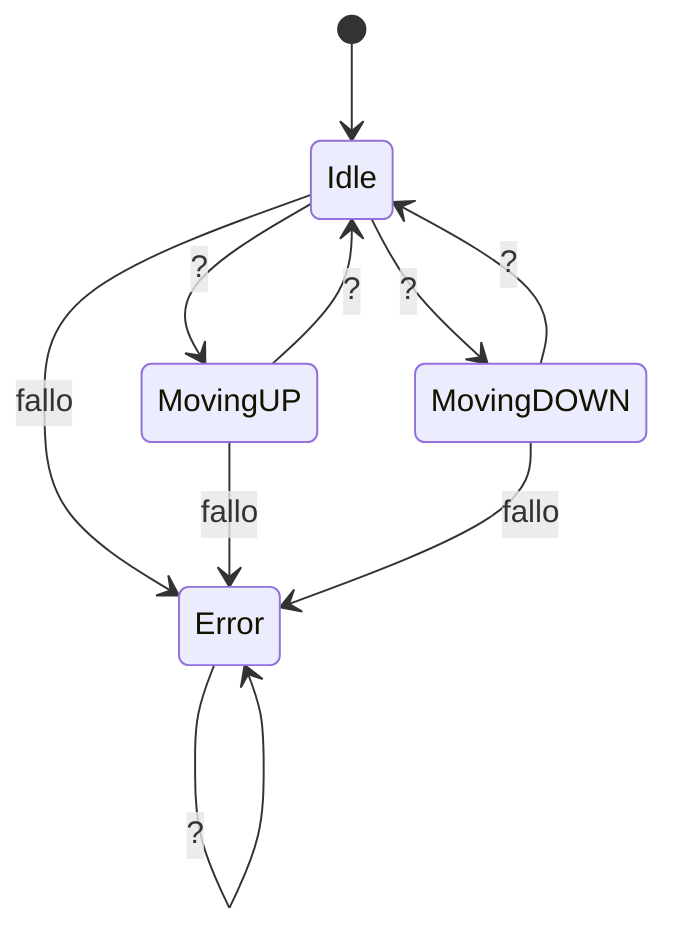

# Examen Máquina de Estados

## Descripción

En el examen tendrás que hacer una máquina de estados que controle el mecanismo del ["Halo de Vigo"](https://hoxe.vigo.org/movemonos/movilidad_vigo_vertical.php?idpoi=4849&lang=gal)

> [!IMPORTANT]
> Respetar TODOS los nombres de estados, transiciones y variables que se especifican en este fichero.
> 
> Si no se respetan *literalmente* no se tendrán en cuenta para la corrección.

## Estados

- Idle: Estado de reposo, puede ser anto en el nivel 0 (nivel Avenida G. Barbón) o como en el nivel 1 (nivel Plaza de Compostela).
- MovingUP: Estado en el que el mecanismo se encuentra subiendo.
- MovingDOWN: Estado en el que el mecanismo se encuentra bajando.
- Error: Estado de error, el mecanismo no se encuentra en ningún nivel y no se puede mover

## Botonera interior

En el interior del ascensor hay una botonera con dos botones:

- `nivel_0` : Botón que indica que se quiere ir al nivel 0 (Avenida G. Barbón)
- `nivel_1` : Botón que indica que se quiere ir al nivel 1 (Plaza de Compostela)

## Niveles

Existen tres tipos de valores para los niveles:

-  0: Nivel Avenida G. Barbón
-  1: Nivel Plaza de Compostela
-  2: El mecanismo se encuentra en movimiento, no está en ningún nivel.
- -1: Error

Estos valores deben ser guardados en una varaible llamada `nivel_actual` que se inicializa a 0.

## Diagrama de estados

