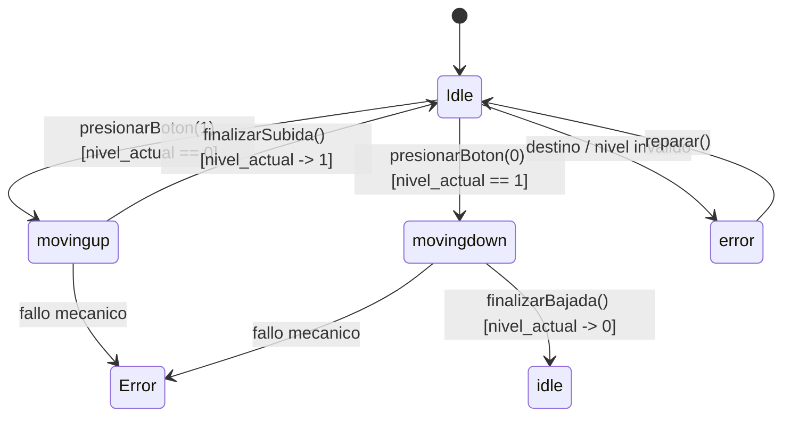
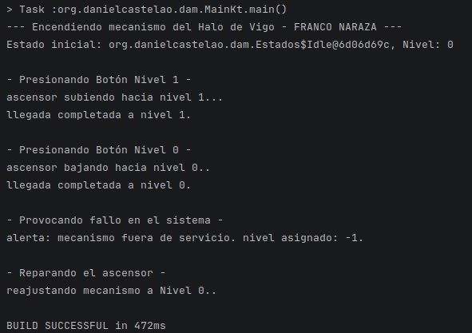
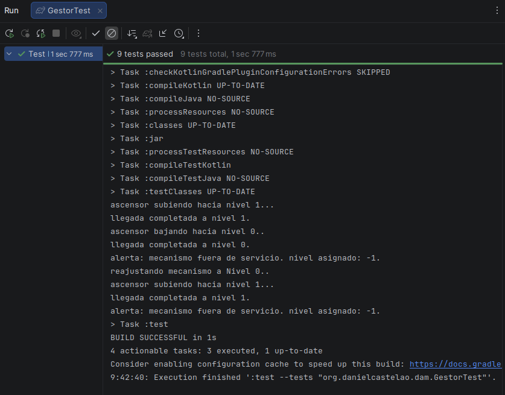

# Examen Máquina de Estados - Franco Naraza

## 1. Explicación de la Solución

Implementé el mecanismo de control de elevación del **Halo de Vigo** en el paquete org.danielcastelao.dam. La arquitectura utiliza el patrón de diseño State Pattern mediante la sealed class Estados, gestionando las transiciones globales a través de las funciones en Gestor.kt y manteniendo total compatibilidad con el código base suministrado.

---

## 2. Decisiones sobre Tipos de Variables

Para cumplir los criterios de calificación sobre variedad de tipos de variables:

| Variable | Tipo de Dato | Ubicación | Justificación |
| :--- | :--- | :--- | :--- |
| nivel_actual | Int | Gestor.kt | Almacena los valores discretos exigidos: 0 (García Barbón), 1 (Plaza Compostela), 2 (Movimiento), -1 (Error). |
| estado_acual | Estados | Gestor.kt | Control de estado activo con polimorfismo seguro. |
| nivel_0 / nivel_1 | String | Gestor.kt | Etiquetas inmutables (val) para representar los botones interiores. |

---

## 3. Implementación de Estados y Funciones Internas

Siguiendo las indicaciones de clase, cada sub-estado de stados incorpora funciones miembro para delegar la lógica de negocio:

- **`Idle`**: Contiene evaluarPeticion() y describirUbicacion().
- **`MovingUP`**: Contiene iniciarSubida() y finalizarSubida().
- **`MovingDOWN`**: Contiene iniciarBajada() y finalizarBajada().
- **`Error`**: Contiene reportarAveria() y obtenerNivelFallo().

---

## 4. Mermaid

## Main Ejecutado:

---

## 5. Pruebas Unitarias

El archivo GestorTest.kt incluye la totalidad de las pruebas unitarias suministradas por el profesor junto con test adicionales creados para validar:
- La navegación completa entre los niveles 0 y 1.
- El manejo de niveles no válidos que conducen a estado de Error (-1).
- La ejecución de las funciones internas encapsuladas dentro de cada estado.
- La recuperación del sistema mediante reparar().

