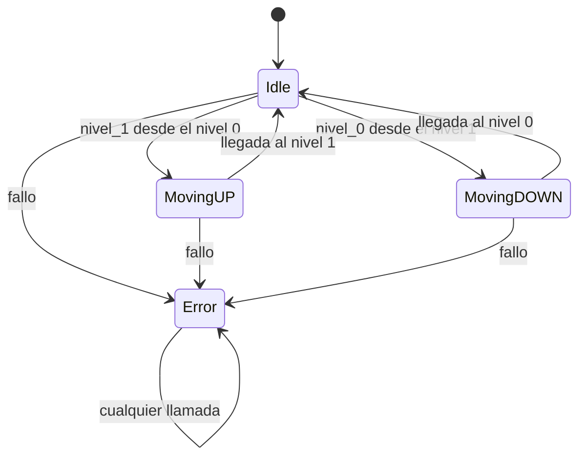
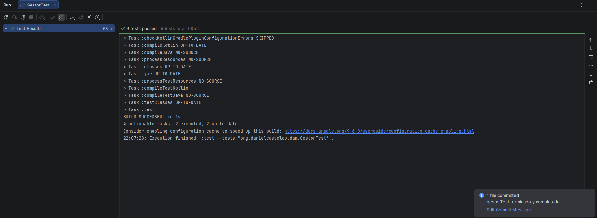

# Examen Máquina de Estados - Franco Naraza

El ascensor empieza en `Idle` en el nivel 0, en la avenida de García Barbón.
El nivel 1 está en la plaza de Compostela. Cada llamada a `gestor()` procesa
un paso y devuelve el valor nuevo de `nivel_actual`.

## Tipos de datos

| Dato | Tipo | Uso |
| --- | --- | --- |
| `nivel_actual` | `Int` | Vale 0 abajo, 1 arriba, 2 durante el viaje y -1 en caso de avería. |
| `Niveles` | `enum class` | Da nombre a los valores del nivel. `Niveles.MOVER.numero` vale 2. |
| `boton` | `Botones` | Usa un `enum class` con `nivel_0`, `nivel_1` y `ninguno`. |
| `fallo` y `llegada` | `Boolean` | Indican si hay una avería o si el ascensor ha llegado. |
| `estado_acual` | `Estados` | Guarda el estado de la `sealed class`. Cada estado es un `object`. |
| `Paso` | `data class` | Guarda juntos el estado siguiente y el nivel que le corresponde. |

## Cómo se procesa un paso

1. `gestor()` guarda el botón y el aviso de llegada en dos variables locales.
   Después limpia las señales para que solo se usen en esa llamada.
2. Si hay un fallo, se obtiene un `Paso` con `Error` y nivel -1. En los demás
   casos, el `when` llama a la función del estado actual.
3. El gestor aplica el estado y el nivel del `Paso` y devuelve `nivel_actual`.

> El fallo tiene prioridad sobre el botón y la llegada. Una vez en `Error`,
> el ascensor sigue fuera de servicio aunque `fallo` vuelva a `false`.

## Qué hace cada estado

- **`Idle`** usa `atenderBoton()` para comprobar si se pide el otro nivel.
  Si sigue parado, `seguirEnReposo()` conserva el nivel 0 o 1.
  Si el valor es inválido, lo corrige a 0.
- **`MovingUP`** empieza en nivel 2 con `empezarTrayecto()`. Después
  `revisarSubida()` decide si sigue subiendo o vuelve a `Idle` en el nivel 1.
- **`MovingDOWN`** empieza en nivel 2. `revisarBajada()` mantiene la bajada
  hasta recibir la llegada y entonces devuelve `Idle` con nivel 0.
- **`Error`** usa `dejarFueraDeServicio()` para mantener el estado de avería
  con nivel -1.

## Transiciones

| Estado actual | Evento | Estado siguiente | Nivel |
| --- | --- | --- | ---: |
| `Idle` en 0 | Se pulsa `nivel_1` | `MovingUP` | 2 |
| `Idle` en 1 | Se pulsa `nivel_0` | `MovingDOWN` | 2 |
| `Idle` | Sin pulsación o se pulsa el nivel actual | `Idle` | 0 o 1 |
| `MovingUP` | Todavía no ha llegado | `MovingUP` | 2 |
| `MovingUP` | Llega arriba | `Idle` | 1 |
| `MovingDOWN` | Todavía no ha llegado | `MovingDOWN` | 2 |
| `MovingDOWN` | Llega abajo | `Idle` | 0 |
| `Idle`, `MovingUP` o `MovingDOWN` | Hay un fallo | `Error` | -1 |
| `Error` | Cualquier llamada | `Error` | -1 |

## Ejemplo de `Main.kt`

1. Pulso `nivel_1` desde abajo y llamo al gestor. Pasa a `MovingUP` y devuelve 2.
2. Llamo otra vez sin indicar la llegada. Sigue subiendo y devuelve 2.
3. Pongo `llegada = true`. La siguiente llamada lo deja en `Idle` con nivel 1.
4. Pulso `nivel_0` y empieza a bajar. Activo `fallo` y llamo al gestor.
   El resultado es `Error` con nivel -1.
5. Quito el aviso de fallo. El ascensor se queda en `Error`.

## Pruebas

`GestorTest.kt` incluye 14 pruebas. La función `comprobarPaso()` compara el
valor devuelto por `gestor()`, el nivel guardado y el estado resultante.
Las pruebas cubren los dos viajes, ambos niveles en reposo, los fallos en
los tres estados operativos y la permanencia en `Error`.

También compruebo que un botón pulsado durante un viaje se descarta y que
una llegada recibida en reposo no termina el viaje siguiente.

